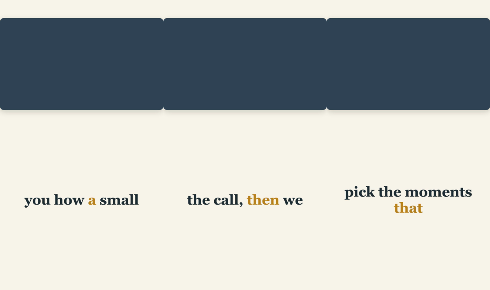

# call-clip-starter

Cut short, captioned clips out of a long recording (a call, a webinar, a screen share). Captions are word-synced to the real transcript, and no cut ever lands inside a word.



Four steps, three small tools:

```
recording ──▶ transcribe.py ──▶ you pick moments ──▶ cut.py ──▶ Remotion ──▶ clip.mp4
              (whisper, local)   (read the .txt)     (word-safe)  (captions)
```

## Quick start

You need Python 3.9+, Node 18+, and [ffmpeg](https://ffmpeg.org) on your PATH.

```bash
git clone <this repo> && cd call-clip-starter
pip install -r requirements.txt
(cd remotion && npm install)
```

**1. Transcribe.** Local and free. Writes `my-call.asr.json` and a readable `my-call.asr.txt` next to the recording.

```bash
python3 transcribe.py my-call.mp4
```

**2. Pick your moments.** Open the `.txt`. Every line has timestamps, so you choose clips by reading. Copy `plan.example.json` to `plan.json` and fill it in:

```json
{
  "video": "/path/to/my-call.mp4",
  "asr": "/path/to/my-call.asr.json",
  "fps": 30,
  "chunks": [[83.2, 91.5], [140.0, 152.3]]
}
```

Each chunk is `[in, out]` in seconds. Use one chunk for one moment, or several to splice moments together.

**3. Cut.** Audit first if you like (`--check` writes nothing):

```bash
python3 cut.py plan.json --check
python3 cut.py plan.json
```

If an in or out point lands inside a spoken word, `cut.py` moves it to just outside that word and tells you. You never get a clipped syllable at a splice.

**4. Render.**

```bash
cd remotion
npm run dev       # preview and tweak in the browser
npm run render    # writes remotion/out/clip.mp4
```

The repo ships with a tiny synthetic sample, so `npm run dev` works before you have cut anything. `cut.py` overwrites it with your clip.

## What makes the captions land

- **Word-level timings from the transcript**, not a guess spread across a sentence.
- **A word belongs to the chunk containing its midpoint.** A word straddling a splice would otherwise get a start inside the cut and an end outside it, and the caption would light up and never turn off.
- **A fresh caption line starts at every splice**, so a line never reads half from one moment and half from another.

## Make it yours

Everything visual is in [`remotion/src/Clip.tsx`](remotion/src/Clip.tsx): colours, font, words per line, layout. The top of the file is the dials. The composition is 1080x1920 (vertical); change it in `Root.tsx` for 16:9 or square.

## Honest limits

- Whisper mishears names and jargon. Skim the caption text before you post; `--model medium` helps.
- The starter does not cut dead air for you or crop to a speaker's face. It is the spine, not the whole editor.
- Tested on macOS with Whisper `base` and `small`. Other platforms should work but have not been run.
- Long recordings (an hour or more): trim the window you care about with ffmpeg first, transcribe that, and set `asr_offset` in the plan to where the window started.

## Not ready to code?

Descript (edit the transcript like a doc) or CapCut (auto-captions, word-by-word styling) get you most of the way with no setup. This repo pays off once you are cutting the same kind of clip again and again.

MIT licensed.
